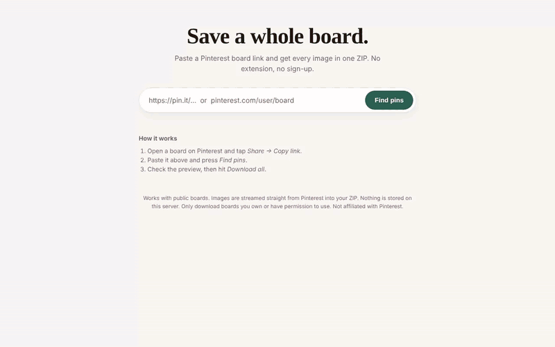
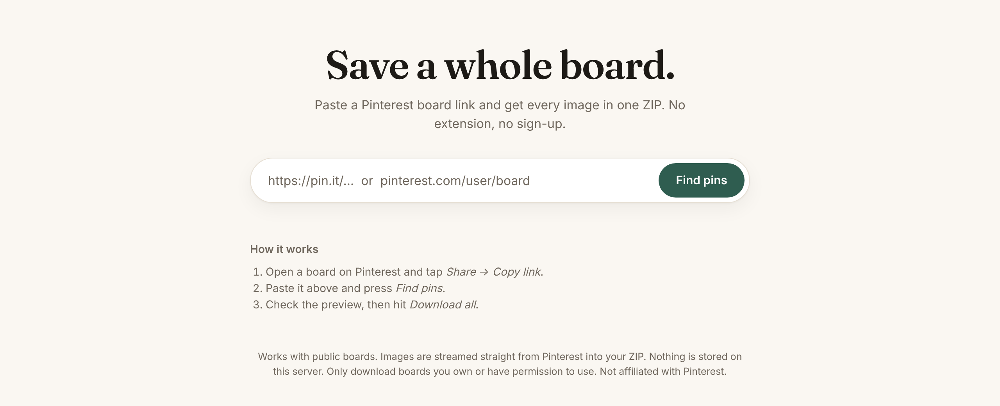
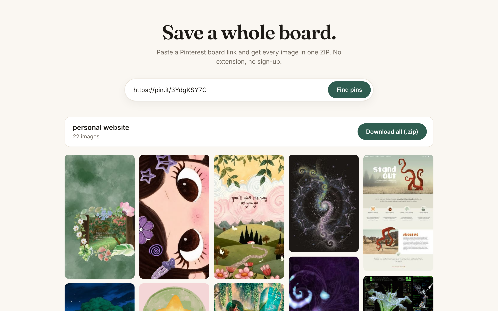
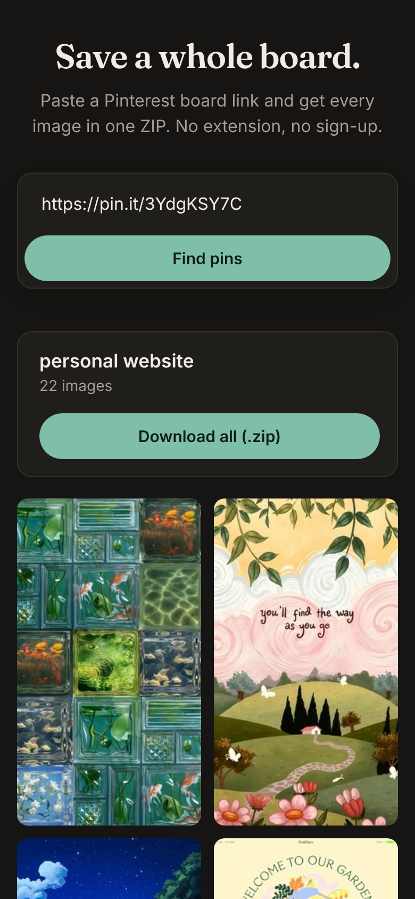

# Board Grab

**Live site: [board-grab.onrender.com](https://board-grab.onrender.com)**

Paste a Pinterest board link and download every image as one ZIP. No extension, no sign-up, free.



<sub>[Watch the full-quality video (MP4)](docs/demo.mp4)</sub>

## Screenshots

| Paste a link | Preview and download |
|---|---|
|  |  |

<p align="center">
  <br>
  <sub>Works on phones, in light and dark mode</sub>
</p>

## How to use it

1. On Pinterest, open a board and tap **Share → Copy link**.
2. Go to [board-grab.onrender.com](https://board-grab.onrender.com) and paste the link.
3. Press **Find pins** to see a preview of everything on the board.
4. Press **Download all (.zip)**.

Short `pin.it/...` links and full `pinterest.com/user/board` links both work, including board sections.

> The site runs on a free server that sleeps when nobody is using it. If it's slow to load,
> wait about 30 to 60 seconds and it wakes up.

## Features

- Downloads full-resolution images and GIFs, numbered in board order
- Preview grid before downloading
- Works on phones and in dark mode
- Nothing is stored. Images are fetched from Pinterest and piped straight into your download.

## Limits

- Public boards only.
- Video pins are skipped because Pinterest streams them, so there's no single file to save.
- Up to 1,000 pins per board.
- To keep the server healthy: 10 scans and 5 downloads per person every 10 minutes.

Please only download boards you own or have permission to use. Not affiliated with Pinterest.

---

## For developers

Built with [FastAPI](https://fastapi.tiangolo.com) and [gallery-dl](https://github.com/mikf/gallery-dl).

| File | What it does |
|---|---|
| `app.py` | Backend: resolves links, lists pins with gallery-dl, streams the ZIP |
| `static/index.html` | The whole frontend (one page, no build step) |
| `Dockerfile` / `render.yaml` | Deployment |

### Run locally

```bash
pip install -r requirements.txt
uvicorn app:app --reload
```

Then open http://localhost:8000

### Deploy your own (Render, free)

On render.com: **New → Web Service**, pick this repo, set the language to **Docker** and the instance type to **Free**.
It also runs on anything that runs Docker (Railway, Fly.io, a VPS).

### Settings (environment variables)

| Variable | Default | What it does |
|---|---|---|
| `MAX_PINS` | 1000 | Max pins per board |
| `SCANS_PER_WINDOW` | 10 | Board scans per IP per window |
| `ZIPS_PER_WINDOW` | 5 | ZIP downloads per IP per window |
| `RATE_WINDOW` | 600 | Rate-limit window in seconds |
| `MAX_CONCURRENT_SCANS` | 3 | Scans running at once, server-wide |
| `SCAN_TIMEOUT` | 120 | Seconds before a scan gives up |
| `TRUST_PROXY` | 1 | Use `X-Forwarded-For` for the client IP. Set to 0 if not behind a proxy. |

### Maintenance

Pinterest changes its site from time to time. If scans start failing, update gallery-dl to the latest
version in `requirements.txt` and push. Render redeploys automatically.
